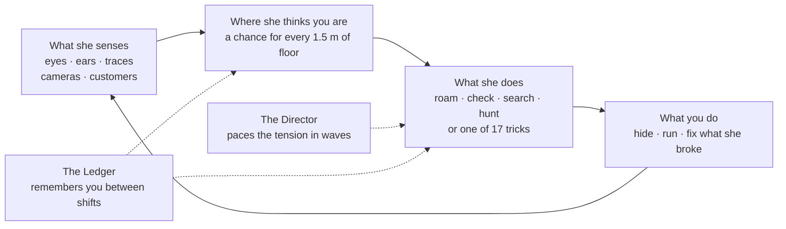
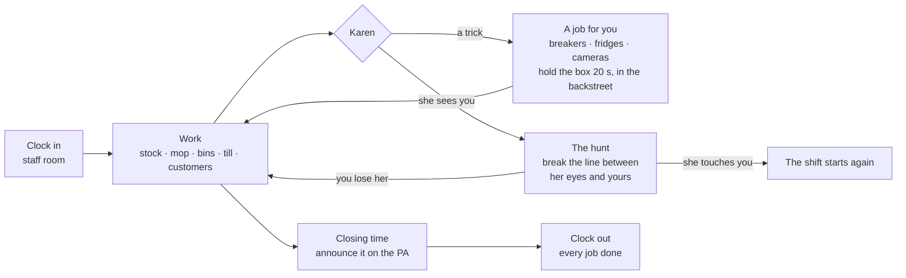
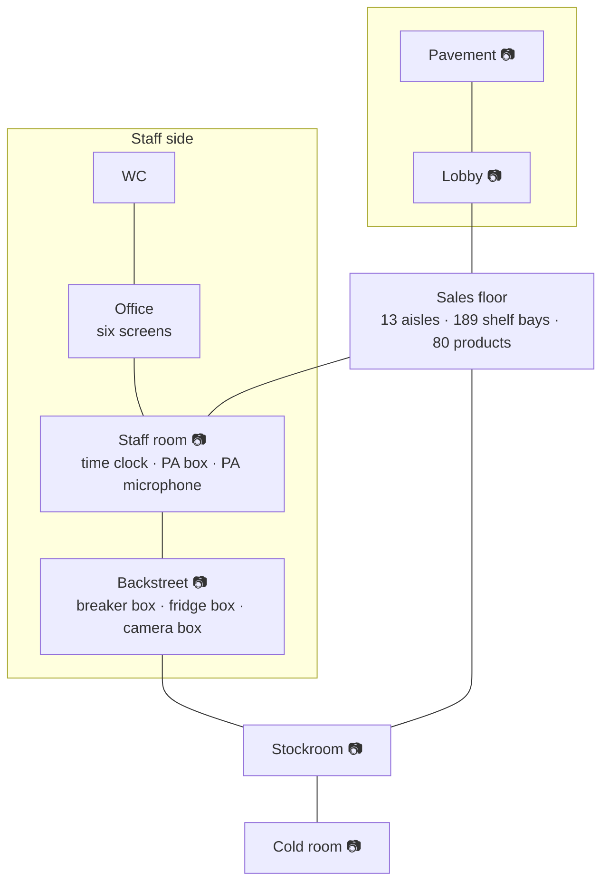

# Kehai

> *kehai (気配): Japanese for "the sense that someone is there"*

A first-person night shift in a convenience store, made in **Unity 6**. Stock shelves, mop
spills, empty the bins, serve at the till and walk lost customers to what they're looking for.
Meanwhile **Karen**, the store's AI, hunts you with what she can see and hear. She remembers
where you hide, and she moves when you blink. Her touch kills.

> *"Employee wellbeing is a tracked metric. I am optimising it."*

**Status:** a playable prototype on its way to a vertical slice; not released. What's being built
now is in [`docs/you/NOW.md`](docs/you/NOW.md), and what's left until release in
[`docs/you/RELEASE_PLAN.md`](docs/you/RELEASE_PLAN.md).

**Karen's full design:** [`docs/agents/karen/Karen.md`](docs/agents/karen/Karen.md). The same on
one page, in plain words: [`docs/you/HOW_KAREN_WORKS.md`](docs/you/HOW_KAREN_WORKS.md).

---

## Karen, in one picture

She never knows where you are. She senses, guesses, and acts on the guess.



| Part | In one line |
|---|---|
| Senses | Sight judged eye to eye, hearing along the floor, traces you leave, cameras, what shoppers tell her |
| The belief map | Spreads while she can't sense you, sharpens when she can, and drops where she looks and finds nothing |
| Tricks | 17 live: Blackout, Fog, Camera watch, Camera break, Shelf sweep, Spill, Ambush, Block door and more. Most leave you a job |
| Fairness | Ten rules in code, checked by tests. She can't read your position, and a shift can always be finished |

## A shift, in one picture



## The store, in one picture

Six rooms have a camera. The office shows all six on a wall of screens: for you, and for her.



---

## The game

- **The shift:** clock in, do the jobs, and clock out once the shelves are full, the spills
  mopped and the bins emptied. At closing time you announce over the PA that the store is
  closed: customers keep coming until you do. Energy drains as you go; coffee helps.
- **The store:** a 60 × 45 m sales-floor maze, power cuts, a radio, automatic doors, and six
  cameras you can watch from the office.
- **Karen:** a body that only knows what it senses, a director that paces the tension, a ledger
  that remembers you across shifts, and a map of where she thinks you are. Hands-on tricks only
  happen where she stands, and she learns where each one works on you. She sprints a little
  faster than you, so break her line of sight.
- **The blink:** opt-in webcam tracking lets Karen act while your eyes are shut. Nothing is
  recorded, and nothing leaves your computer ([`tools/blink`](tools/blink/README.md)).
- **Seeing what happened:** a live map (**F1**), a replay of the shift (**F2**), an HTML report
  after every shift, a full 3D replay, and in the **Esc** menu every key and every one of
  Karen's tricks with a short video.

## This repository

It holds the **code and documents only**: C# scripts (with their `.meta` files), the shader, the
Python, Swift and TypeScript tools, and the docs. Scenes, models, audio, video, prefabs and
project settings stay on the developer's computers, so this isn't a runnable Unity project on
its own. Data that would normally live in assets (Karen's tricks, the products, the shelf plan,
the store's cameras) is written in code so it can be read here.

Unity 6 (6000.5), C#, URP, NavMesh, TextMesh Pro · Swift for the macOS blink helper · Python for
the tools.

---

## Layout

The code, the tools and every document, in one tree. The docs are split by reader: `docs/you/`
is short and is what the owner reads and edits; `docs/agents/` is long and exact, for coding
agents.

```
Assets/!_Project/
├── _Core/            the shift, tasks, burnout, settings, pause, the UI theme; the build script
├── _Game/
│   ├── AI/           Karen: core, perception, belief, decisions and tricks, world, diagnostics
│   ├── Blink/        blink sources, tracker, calibration
│   ├── Eval/         headless environment, simulated players, ablation runner, trick check
│   ├── Level/        shelves, planogram, doors, power, bins, spills, the store's cameras and wall boxes
│   ├── Map/          the store map Karen uses, and the floor plan people look at
│   ├── Replay/       recording shifts and the 3D replay
│   ├── Playtest/     playtest builds: session log, consent, questions, upload
│   ├── Characters/   customers
│   ├── Items/        products and tools
│   └── Player/       movement, hands, eyelids, menus, the HUD
└── _Tests/Editor/    EditMode tests

tools/
├── blink/            webcam helpers (Apple Vision, MediaPipe) and model training
├── eval/             Python clients for the AI test environment; ablation analysis
├── marketing/        the video automation (Python, Remotion)
├── playtest/         the playtest upload service (Cloudflare)
├── rl/               training Karen's policy (ML-Agents)
├── scene/            the scene map generator
├── tricks/           records the trick videos shown in the Esc menu
└── website/          the home page draft

docs/
├── you/                              short pages for the owner
│   ├── NOW.md                        start here: what's being built, what waits on the owner, what's next
│   ├── HOW_KAREN_WORKS.md            Karen in plain words, with pictures
│   ├── DECISIONS.md                  the owner's calls, one dated line each
│   ├── IDEAS.md                      blink, the endless maze, the AI test environment, ablation, memory ideas
│   ├── RELEASE_PLAN.md               everything left until release, in order
│   └── plans/
│       ├── 0.4.0-build-plan.md       Karen 0.4.0: two trained Karens, players that feel real (being built)
│       ├── playtest-v2.md            real players: how their shifts get recorded and uploaded (not built)
│       ├── 0.2.0-tuning-plan.md      turning her down: the levers and the test (open questions)
│       └── marketing-agents.md       hands-off video publishing
└── agents/                           long and exact, for coding agents
    ├── RULES.md                      the working rules, in one place (CLAUDE.md and AGENTS.md point here)
    ├── HANDOVER.md                   where everything is on the Mac; how to test, build and verify
    ├── DECISIONS.md                  the big technical choices and why
    ├── CHANGELOG.md                  changes players will notice
    ├── karen/Karen.md                ★ Karen's full design, and where the code differs
    ├── results/KAREN_RESULTS.md      what testing Karen found
    ├── store/
    │   ├── STORE.md                  the building, the products, how the shelves are stocked, Karen's map
    │   ├── SCENE_MAP.md              where everything is in the Unity scene (generated)
    │   ├── STORE_MAP.md              Karen's map of the store: regions, links, chokepoints (generated)
    │   ├── LEVEL_DESIGN.md           plans for the parking lot, the outside, the lobby and the staff rooms
    │   └── INTERIOR_MODELS.md        the staff room, office and model library as built
    ├── game/
    │   ├── CONTROLS.md               every key (the same list is in the game: Esc, then Keys)
    │   └── PLAYTEST.md               how playtests run
    ├── marketing/MARKETING.md        the pitch, the videos, the automation
    ├── research/whiteboard-2026-11-05.md   how Alien: Isolation and Hello Neighbor hunt you; Kehai's three pillars
    └── archive/                      finished and replaced plans
        ├── 0.3.0-build-plan.md       Karen 0.3.0, the tricks rebuilt (merged)
        ├── 0.2.0-build-plan.md       Karen 0.2.0, task by task (merged)
        ├── 0.2.0-design-notes.md     why 0.2.0 is built that way
        ├── karen-learning.md         the first learning plan, replaced by 0.4.0
        ├── learned-motion-model.md   the learned motion model (PR #68, closed), redesigned inside 0.4.0
        ├── karen-capture.md          what catches you, and new fair ways to kill (partly taken into 0.4.0)
        ├── notmerged.md              old: the 20 October status, how Karen adapts
        ├── reactive-bots.md          old: the reactive simulated players plan (built in PR #62)
        └── readchanges.md            old: the first redesign plan, replaced by the 0.2.0 plan
```
