# Not merged yet

Three things in one place, as of 2026-10-20:
1. **What's left to build** — Karen's ML work first, then the rest of the game.
2. **How Karen adapts**, explained simply, with a diagram for each part.
3. **All the tech used**, with the proper names (PPO, Bayes filter, UCB…).

The diagrams are [Mermaid](https://mermaid.js.org/): GitHub and most Markdown previews draw them as pictures.

---

## 1. What's left to build

### 1.1 Started, not merged

| what | where it is | how far | what's left |
|---|---|---|---|
| **Learned motion model** (see [2.11](#211-the-learned-motion-model-in-progress)) | local branch `feat/learned-motion`, not pushed | About half. Built: the motion interface (the old predict step as M0, bit-for-bit), M1–M4 in C#, shadow filters, the trace logger, Python replay and training. All parity checks pass, and the primary metric is pre-registered. | Re-run the tests in Unity; fit M1 and train M2–M4 on the 288 collected shifts; run the 144-shift test and the 48-shift closed loop; write up the results; make M3/M4 fast enough (17–22 ms a tick unsliced, against a 0.7 ms budget); push and open the PR |
| **Doors, cold room, lockers, exterior fit** | [PR #64](https://github.com/goraxyy/Kehai/pull/64) (`codex/environment-fit`) | open | review, merge |
| A local edit | `Level/Editor/ColdStoreBuilder.cs`, uncommitted in the main folder | — | commit it or drop it |

### 1.2 Karen's ML: not started

| piece | what it would learn | replaces | it works when | status |
|---|---|---|---|---|
| **Train rung F (PPO)** | which trick to use, from how the player reacts | the bandit | it beats rung E on the same seeds | Pipeline built and smoke-tested (601 steps). Real training not run: the Mac overnight, plus university Windows PCs |
| **Real players** | — (the data for everything here) | the bots | — | Playtest pipeline built. Waits on a Cloudflare deploy, the Telegram and Claude keys, the itch.io page and the Google Form |
| **Learned Panic Index** | how scared you are, from how you move | the hand-tuned Panic Index | it matches players' own fear ratings | idea; needs real players |
| **Contextual bandit** | what a trick is worth *right now* (time left, energy, where you are) | the plain bandit | it beats rungs D and E | idea |
| **Red-team agents** | ways to break her fairness rules or exploit the bots | — | they find a violation the checker misses | idea |
| **Windows webcam blink** | — | the keyboard blink (B) on Windows | — | decide: a MediaPipe helper, or keyboard only |

### 1.3 Known gaps in Karen

- **She can stand on a stuck player** without catching them.
- **The Director cheats a little.**
  - After 45 s without a sighting, it nudges her belief toward your *real* region (`KarenDirector.MaybeBias`).
  - The published out-of-view belief numbers include that hint.
  - The motion-model work measures without it.
- **The belief grid's `Danger` layer is never filled.** So her guess of your movement ignores that you avoid her. The motion model's M1 fills it.
- **The efficient bot backs off 90–120 times a shift.** Her `follow` trick keeps her about 2 m behind it.
- **Docs out of date:**
  - The README says "she gives you overtime", but a touch now kills.
  - `DECISIONS.md` says she can't outrun a sprint, but she's now 5% faster than you.

### 1.4 The rest of the game ([RELEASE_PLAN.md](RELEASE_PLAN.md))

| milestone | what's left |
|---|---|
| Setup | Steamworks, a social handle, website, Discord, the Claude / Azure / Telegram / Buffer / Cloudflare keys, Google Form, itch.io, turning off dry runs |
| 1 · Vertical slice | Tune Karen with real people. Player and customer animation, feedback sounds, audio pass 2, lighting, camera feel. Test the Windows build on a real PC |
| 2 · Steam page | app ID, title check, capsule art, screenshots, trailer, store text, review |
| 3 · Playtesting | weekly self-play, round 1 (5 new players), round 2, Steam Playtest |
| 4 · Demo, Next Fest | cut a demo, a demo app, pick a festival and apply |
| 5 · Marketing | educational and update long videos, Reddit, press kit, YouTuber outreach, 2 shorts a week |
| 6 · Beta | every shift playable, difficulty curve, decide the endless maze, languages, accessibility, licences, feature freeze |
| 7 · Redesign | final art, audio and UI |

---

## 2. How Karen adapts, in simple terms

### 2.1 The big picture

Karen is a loop:
1. She **senses** you.
2. She **guesses** where you are.
3. She **picks** a trick.
4. She **warns**, then **acts**.
5. She **watches** how scared you got, and **remembers** it.

Every shift, her guesses and her choices fit *you* a little better.

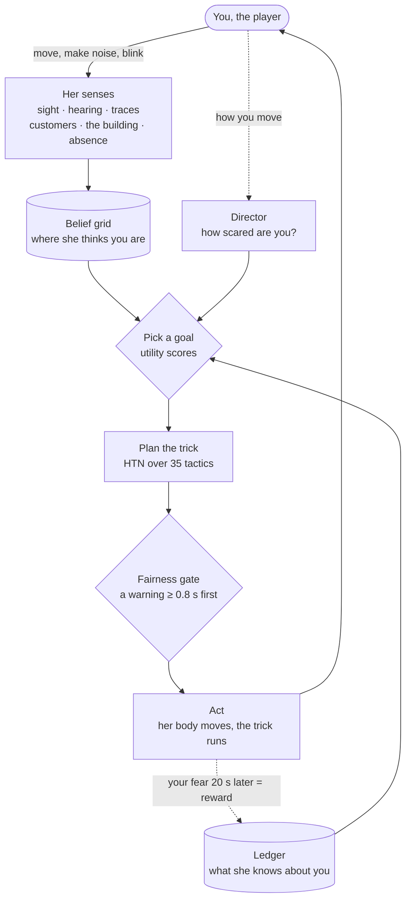

### 2.2 Three minds

| mind | job | how often | example |
|---|---|---|---|
| **Body** | senses, moves, carries out tricks | every frame | walks to Aisle 6 because she heard a can drop there |
| **Director** | paces the fear: when to push, when to back off | a few times a second | "she's been calm too long, so allow the scary tricks" |
| **Ledger** | remembers you, across shifts | after every trick | "PA decoys work on this player; they hide in Aisle 8" |

### 2.3 What she can sense (and what she can't)

| sense | what it gives her | example |
|---|---|---|
| **Sight** | graded, not yes/no: closer, brighter and longer means surer | a glimpse at 20 m in the dark is weak; 3 m under a light is certain |
| **Hearing** | sounds on an event bus, not physics queries | sprinting, dropping things, doors |
| **Traces** | the world remembers you | wet footprints, a mopped floor, a moved crate |
| **Customers** | they're her sensor network | "the employee went that way" |
| **The building** | she owns it | the time clock, power, doors, the PA |
| **Absence** | she looked and you weren't there | sweeping Aisle 6 and finding nothing removes Aisle 6 from her guess |

**The one rule:** she never reads your true position. A test fails the build if her code tries.

### 2.4 Where she thinks you are: the belief grid

- **The grid:** the store is cut into 4,713 cells of 1.5 m, and each cell holds the chance that you're there. This is a **Bayes filter** (a histogram filter).
- **Correct:** when evidence arrives, multiply it in.
- **Predict:** between pieces of evidence, let the chance spread the way a person can walk.
- **How often:** both steps run 10 times a second.

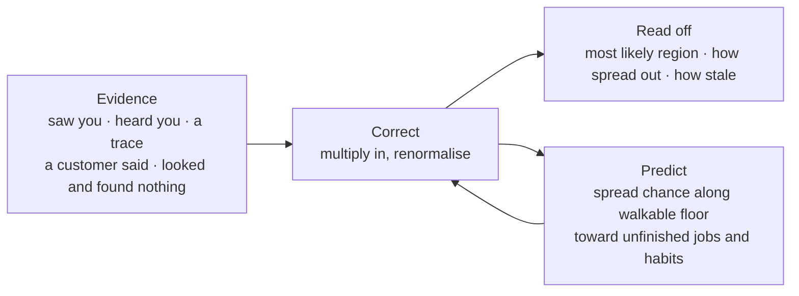

**Example.** She hears a can drop in Aisle 6, and the chance piles up there. She walks over and finds nothing, so the chance drains out of Aisle 6 into the aisles next to it. A minute later the chance has leaked toward the bins you haven't emptied yet: that's where you'd go.

### 2.5 Choosing what to do: goal → plan → trick

1. **Pick a goal by score (utility AI).** The goals:
   - Patrol, Investigate, Sweep, Flush, Deny, Herd;
   - Ambush, Stalk, Pursue, Withdraw, Assist.

   Each goal gets a score from:
   - how well it fits the moment (how sure she is where you are, how much work you have left);
   - how much fear it should cause;
   - how new it is.
2. **Plan it (HTN, a hierarchical task network).** The goal breaks into steps, and the tricks fill them in.
3. **Pick the trick.** It comes from 35 tactics, scored by the Ledger (2.8), or by the PPO policy at rung F (2.10).

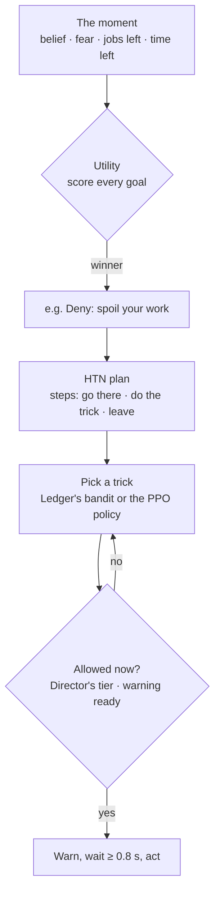

**The 35 tricks, by what they attack:**

| family | examples |
|---|---|
| your sight | `blackout`, `fog`, `mirror_black`, `camera_bolt_on` |
| your work | `spill`, `shelf_sweep`, `bin_tamper`, `tool_theft`, `task_falsification` |
| sound and trust | `pa_decoy`, `pa_footsteps`, `phantom_chime`, `mimicry`, `silence` |
| space | `crate_wall`, `door_lock`, `funnel`, `shelf_relocation` |
| the customers | `witness`, `poll_witnesses`, `understudy` |
| you directly | `follow`, `stalk`, `chase`, `ambush`, `overtime`, `favour` |

### 2.6 Pacing the fear: the Director

**The Panic Index** is her estimate of how scared you are, read from 8 things you do:
- sprint bursts;
- yaw jitter (looking around);
- path inefficiency;
- abandoning tasks;
- freezing;
- dropping things;
- how fast your energy falls;
- how often you blink.

**The control loop.** The Director wants that number to sit at a target (the **setpoint**). It uses a **PI controller**, the same maths as a thermostat:
- `pressure = 0.8 × error + 0.02 × the error added up over time`;
- high pressure unlocks the scarier tiers of tricks, and negative pressure means back off.

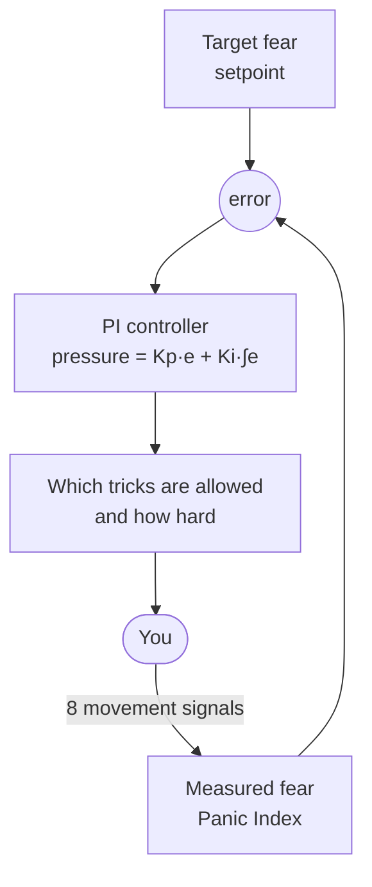

**Waves, not constant tension.** A shift goes in waves, so the scares land:

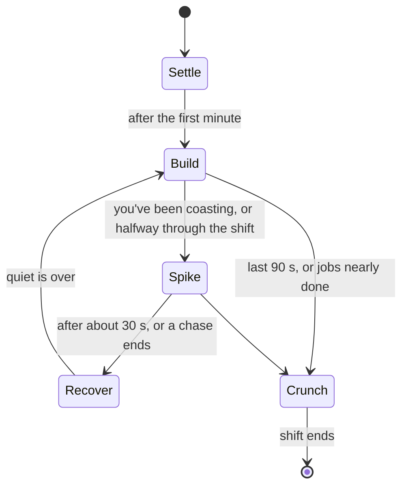

If your fear goes far over target, she backs off for 90 s on purpose. Scares that never stop stop working.

### 2.7 The blink dash

With the optional webcam, she knows when your eyes are shut, and the dash is a wave beat that uses that:
- **Close in:** you blink while she's far off but in view, and she's suddenly much nearer.
- **Vanish:** you blink while she's in view, and she's gone. She waits, then steps out somewhere you didn't expect.

Her eye flickers at least 0.8 s first, so there's always a warning.

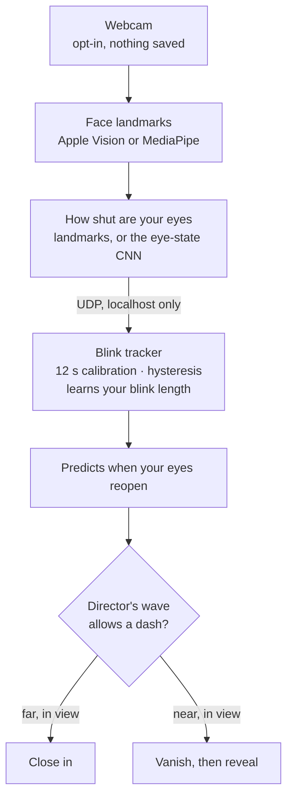

### 2.8 Learning what works on you: the bandit and the Ledger

Every trick is an arm of a **multi-armed bandit**:
1. She tries a trick.
2. She measures how much your fear changed over the next 20 s. That change is the reward.
3. She updates what she expects that trick to do to *you*.

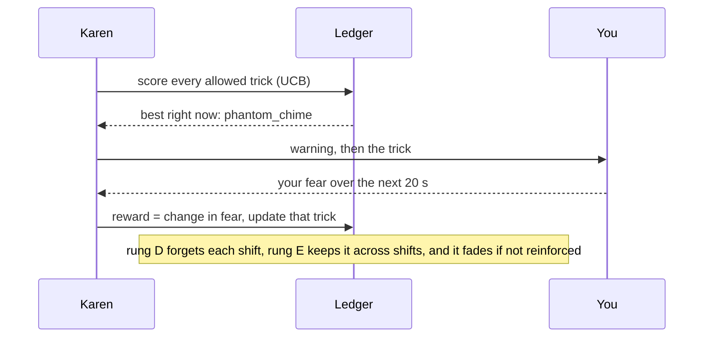

**How she scores a trick (UCB):**

> score = what it usually does to you + a bonus if she hasn't tried it much − a penalty if she used it a moment ago + a starting guess that fades as she learns

- **The bonus** (`c·√(ln t / n)`) makes her try new things.
- **The penalty** (habituation) stops her repeating herself.
- **Thompson sampling** can be switched on instead.

**What else the Ledger remembers about you:**
- where you spend time;
- where you hide;
- the routes you take between jobs.

She uses those to wait on your usual way, or to search your favourite hiding spot first. It all fades, so if you change how you play, it works within two shifts. That's a fairness rule.

### 2.9 Using the map: chokepoints and herding

The store is also a **graph**: regions linked by walkable openings.
- **Chokepoints** are **articulation points** (found with Tarjan's algorithm): the places that, if blocked, cut the store in two.
- **Herding** is a **min-cut**: a max-flow / min-cut (Edmonds–Karp) from where she thinks you are to where you'd rather be. It gives the cheapest set of openings to block.
- **The funnel:** she blocks all but one, and waits near the last.

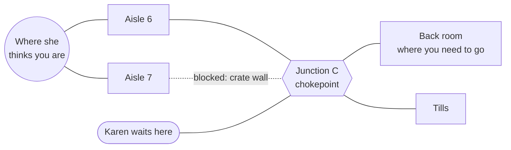

**Example.** You need the back room. She blocks Aisle 7 with a crate wall and stands near Junction C. Every way you take goes past her.

### 2.10 The trained policy: rung F (PPO)

Rung F swaps the bandit for a small neural network trained with **PPO** (Proximal Policy Optimization, a reinforcement-learning method), using **Unity ML-Agents**. Everything else stays hand-built:
- the belief;
- the goals;
- the plans;
- the warnings;
- the fairness rules.

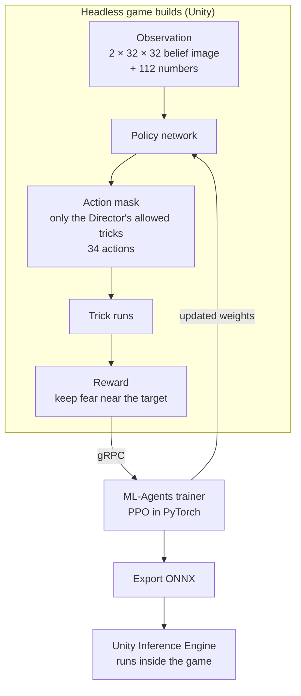

- **Demonstrations:** recorded from the bandit's own choices, to give training a head start.
- **Where it stands:** built and smoke-tested; not trained yet.

### 2.11 The learned motion model (in progress)

Today the predict step in 2.4 is hand-written guesswork with 5 hand-set dials. The plan is to *learn* it from player movement, and to judge it on the metric that matters: how much chance she puts on where you really are when she can't see you.

**The ladder.** Each rung asks one question:

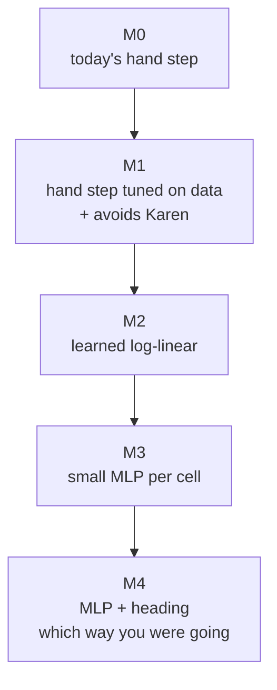

| rung | question |
|---|---|
| M0 | the baseline she ships with |
| M1 | the fair baseline: same inputs, structure set by hand |
| M2 | does learning beat hand tuning? |
| M3 | does a bigger model help? |
| M4 | does remembering your direction help? |

For every cell, each model outputs:
- a **leave rate**;
- a **softmax over its walkable neighbours**.

So chance only moves along the floor, and it always adds up to 1.

**How it's trained.** It's a **learnable histogram filter**: trained *through* the filter, on the metric itself.

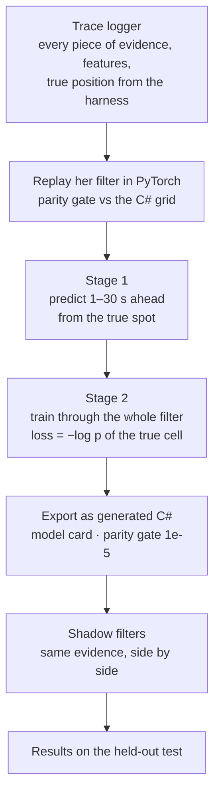

**Data:**
- 432 shifts: 216 train, 72 validation, 144 test, split by seed.
- The test set is opened **once**.
- The **cautious** player type is never trained on.

**The win rule, written down before the test:** out-of-view log-likelihood, best model minus M1, with a 95% bootstrap interval (resampled by career) above zero. If M2–M4 only tie M1, the finding is "tuning the hand step is enough", and it gets reported that way.

### 2.12 Fairness: rules she can't break

- **No omniscience:** she knows only what she senses, and a test enforces it.
- **Every trick is warned** at least 0.8 s ahead. A checker logs any violation: 0 in the last 300 shifts.
- **A touch kills,** but walking up to you is something she only does running (a chase or a lunge). Otherwise she stops 2.2 m short of where she sees you.
- **Her memory fades,** so changing how you play works within two shifts.
- **The Director's waves guarantee quiet** after a spike.

### 2.13 How we test any of this

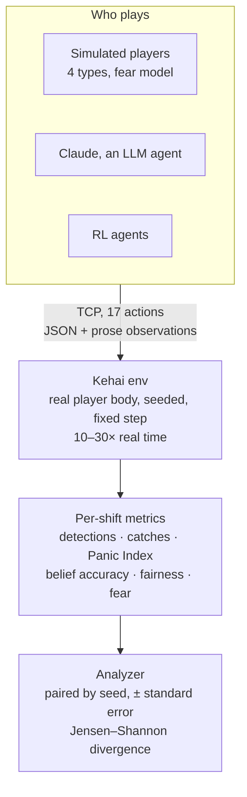

**The ablation ladder.** Each rung adds one thing, so the difference between neighbouring rungs is that thing:

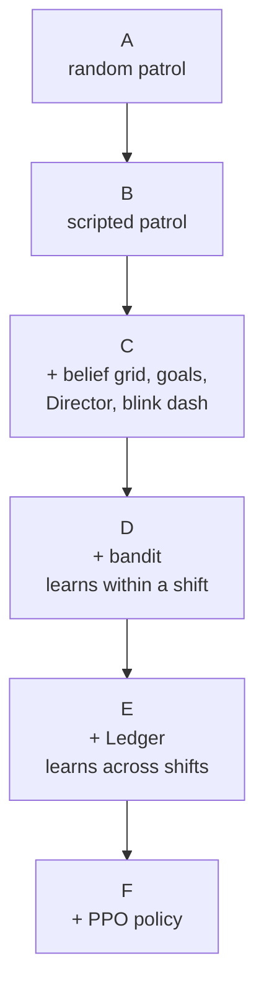

**The simulated players** feel fear from what they sense, each type in its own way, and show it through the same 8 signals the Panic Index reads:

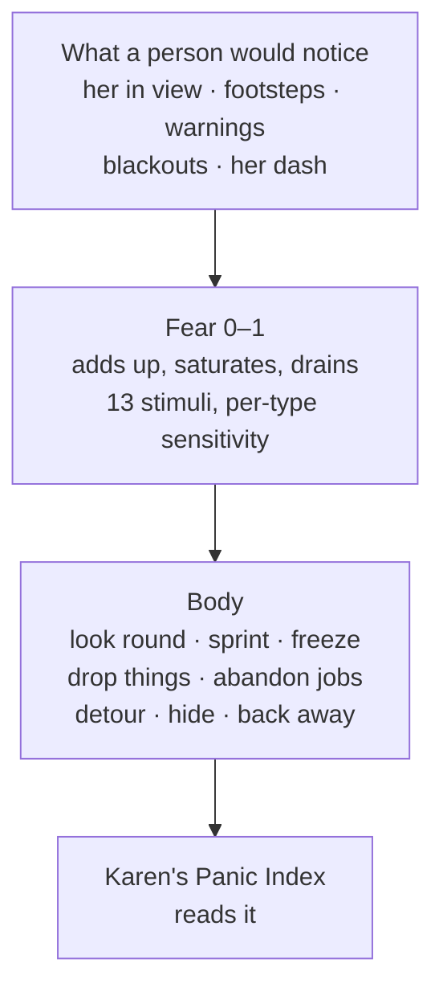

The four types are efficient, skittish, reckless, and **cautious**. Cautious is held out: it's used only for testing, never for tuning or training.

### 2.14 What the tests say so far (300 shifts)

| question | answer |
|---|---|
| Does the belief grid and planning (C) beat patrols? | **Yes.** It finds you in 31 s, against 85–101 s, finds you every shift, and detects you about 6 more times a shift |
| Does learning (D, E) beat planning alone? | **Not yet.** It lowers fear slightly (−0.03 to −0.04) without hitting the target any better |
| Does she adapt to each player? | **A first sign.** At E, her mix of tricks differs by player about twice as much as at C, most of all against the held-out cautious player |
| Do reacting players help her learn? | They give her 1.5–4× more tricks per shift to learn from, but no bigger reward per trick |
| Is she fair? | **0 violations** in 300 shifts |

Full tables: [KAREN_RESULTS.md](KAREN_RESULTS.md).

---

## 3. All the tech

| area | tech and techniques |
|---|---|
| **Engine** | Unity 6 (6000.5), C#, URP, NavMesh, GPU Resident Drawer, GPU occlusion culling, rendering layers, TextMeshPro, EditMode tests (NUnit) |
| **Karen: classical AI** | Bayes / histogram filter (belief grid with negative evidence), utility AI (goal scoring), HTN planning, graph search on a region graph, Tarjan articulation points, max-flow / min-cut (Edmonds–Karp), PI control (pacing), a finite-state wave director |
| **Karen: learning** | multi-armed bandit (UCB with a habituation penalty, optional Thompson sampling, fading priors), a persistent player model (Ledger), **PPO** reinforcement learning with action masking (Unity ML-Agents 4.1, `mlagents` 1.1, PyTorch), demonstration recording, ONNX, Unity Inference Engine |
| **Learned motion model** (in progress) | learnable histogram filter, log-linear model, MLP, a heading-augmented state, truncated backprop through time, trajectory pretraining, generated-C# weights with a model card, parity gates, shadow filters, a pre-registered metric, bootstrap confidence intervals |
| **Perception ML (blink)** | Swift + Apple Vision face landmarks, MediaPipe, OpenCV (capture, eye crops), an eye-state CNN (PyTorch), dataset recorder and labeller, per-user calibration, hysteresis, blink-length learning, UDP on localhost |
| **Evaluation** | a Gym-style environment over TCP, a Python client, an LLM agent (Claude API), scripted baselines, seeded paired ablations, standard errors, Jensen–Shannon divergence, belief-accuracy metrics (log-likelihood, top-k, error), simulated players with a fear model, a fairness checker, an agent failure taxonomy |
| **Procedural generation** | the endless maze: seeded chunk hashing, Kruskal's algorithm, braiding, streaming, object pools, off-main-thread NavMesh |
| **Replays and telemetry** | event recording (not re-simulation), 3D replay, a thought log, HTML shift reports |
| **Marketing automation** | Python, launchd, Claude API, Azure Speech (TTS), Remotion (TypeScript video), a Telegram Bot API approval flow, Buffer, per-call cost caps, dry runs |
| **Playtest pipeline** | Cloudflare Workers + R2 (write-only upload key), tester codes, consent, in-game questions, Telegram alerts, Claude summaries |
| **Tooling and process** | Git and GitHub (60+ PRs), headless batch Unity on APFS copy-on-write clones, offline C# compile checks, Blender (80 textured products), design docs and a decision log |
