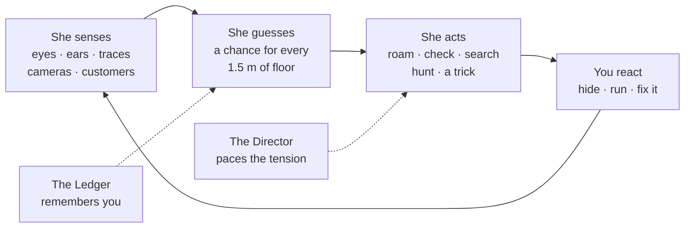
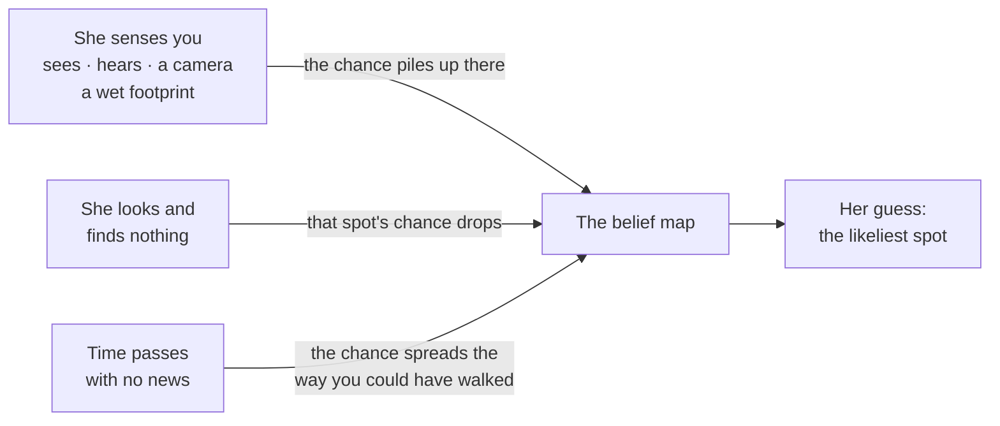
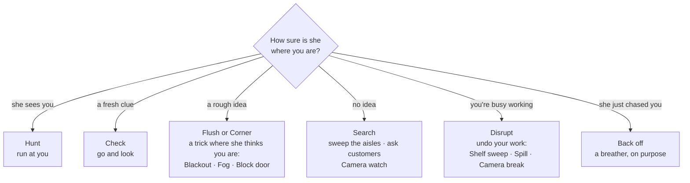
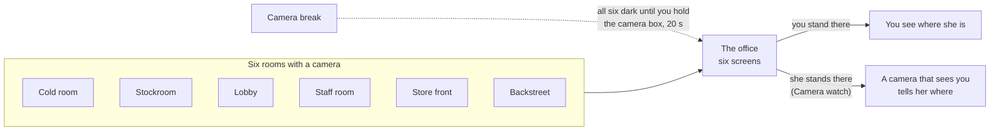

# Karen, in plain words

One page, with pictures. Every number, file and test is in the full design,
[`docs/agents/karen/Karen.md`](../agents/karen/Karen.md).

**What she is.** The store's AI, with a body. She never knows where you are. She only uses what
she sees, hears and finds, and she acts on her best guess.

## 1. The loop



## 2. What her eyes see

One rule since 0.4.1: **she sees you only if there is a clear line from her eyes to yours.**

```
  her eyes ●━━━━━━━━━━━━━━━━━━━━━━━━━━━● your eyes     SEEN       nothing between you

  her eyes ●━━━━━━━━━━━━━━━━━━━━━━━━━━━● your eyes     SEEN       a short shelf hides your
                        ▄▄▄▄▄▄                                    body, not your eyes
                        █shelf█         (half as fast)

  her eyes ●━━━━━━━━━━━━━╳                             NOT SEEN   you're under a rack: the
                   ═════╩═══════ rack board                       boards are between her
                              ● your eyes                         eyes and yours
```

| She notices you faster when | Slower when |
|---|---|
| you're close, in front of her, in the light, running | you're far, at the edge of her view, in the dark, crouched or still |

- **How far:** 72 m, across the whole store (36 m before 0.4.1).
- **How fast:** walking 10 m away in a lit aisle, about a quarter of a second (0.67 s before).
- Fog cuts every eye to 2 m: hers, her cameras', yours.

## 3. Where she thinks you are

A chance for every square of floor. Three things move it:



Example: you drop a box in Aisle 3 and walk off. She hears it, her guess jumps to Aisle 3, she
looks down it and sees nothing, and the guess moves on to the aisles you could have reached.

## 4. How she decides

Twice a second she scores her options and takes the best. Roughly:



Once she starts a trick she does by hand, she finishes it, unless she starts a hunt.

## 5. Her tricks

17 live ones. The Esc menu's **Tricks** tab has each in three lines, with a video.

| She attacks | Tricks | What it costs you |
|---|---|---|
| Your sight | Blackout · Fog · Camera bolt-on · Camera watch · Camera break | hold a box in the backstreet for 20 s, or unplug her camera |
| Your work | Shelf sweep · Spill · Bin tamper · Tool theft · the overtime | do the job again |
| Your nerves | Phantom chime | nothing: she's listening for whether you go and look |
| Your way | Block door | go round, pick the box up |
| You | Ambush · Cut · Throw · Ask the customers · the understudy (Kenji) | change your route; send Kenji to the tills |

## 6. The cameras



The cameras tell her nothing unless she is standing at the screens. While she is, she isn't on
the floor.

## 7. A shift's shape

The Director paces it in waves, so it isn't one long chase:

```
 tension
   ▲            ╭─╮                    ╭──╮                 ╭───╮
   │        ╭───╯ ╰╮               ╭───╯  ╰╮            ╭───╯   │ closing
   │    ╭───╯      ╰──╮        ╭───╯       ╰──╮     ╭───╯       │ time
   │────╯  build  spike╰────────╯  build  spike╰─────╯           ╰──►
   └──────────────────────────────────────────────────────────────── time
    settle            breather                 breather     you announce it on the PA
```

After a chase she gives you at least 45 s without a big trick. Once you've announced that the
store is closed, she makes you no new jobs.

## 8. What she remembers

The Ledger keeps, between shifts: your routes, where you hide, how fast you fix each trick, and
which tricks rattled you. Example: you always hide in the lockers, so she checks them first.
What she learned fades if you change, within about two shifts.

## 9. The rules she plays by

Ten rules in code, checked by tests. The ones you feel:

| Rule | Meaning |
|---|---|
| She can't read your position | only what she senses |
| A breather after a chase | 45 s, no big tricks |
| Tricks by hand happen at her hands | she has to walk there |
| A shift can always be finished | no new job once the store is closed |

## Is she machine learning?

Not yet. Today she is hand-built probability and planning, plus a small picker that learns which
tricks work on you. **Nothing has been trained.** The
[0.4.0 plan](plans/0.4.0-build-plan.md) trains three things: where you go when she can't see you,
the bots that play against her, and two versions of her brain.

## Her versions

| Version | What changed | State |
|---|---|---|
| 0.2.0 | her eyes, the Hunt, guesses at your route, two new tricks | merged |
| 0.3.0 | the tricks rebuilt; no new chore after closing; she finishes what she starts | merged |
| 0.4.0 | two trained Karens: Vital (paid for catching you) and Basic (paid for pacing your fear) | being built |
| 0.4.1 | eyes judged eye to eye, twice as far and as quick; six cameras and two tricks; closing on the PA | in a pull request |

## How she's tested

Simulated players run seeded shifts against each version of her, in pairs, and one kind of player
(the cautious one) is never used for tuning. What the tests found, bad results included:
[`KAREN_RESULTS.md`](../agents/results/KAREN_RESULTS.md). **0.4.1's eyes haven't been through
that test yet.**
